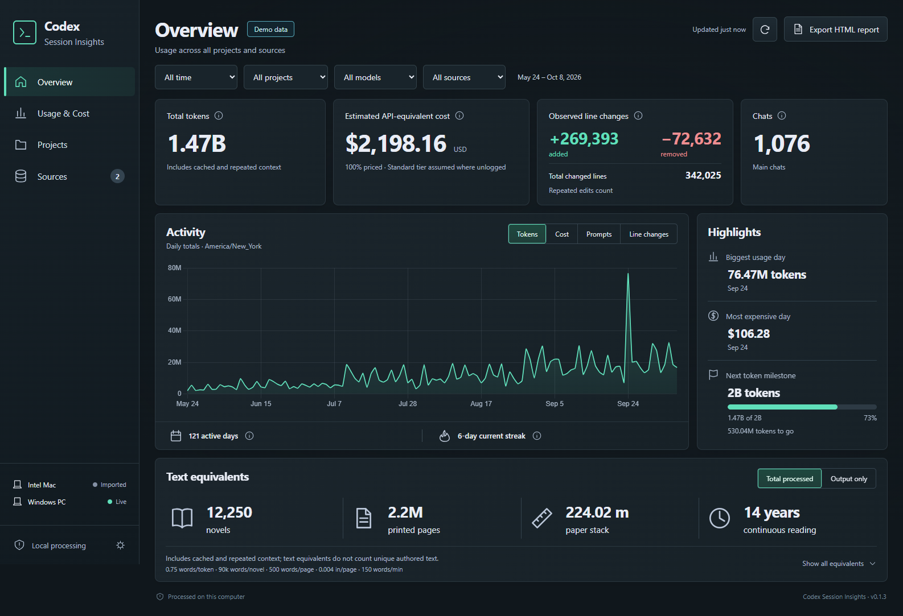

# Codex Session Insights

A small local dashboard for the wonderfully unreasonable amount of text you put through Codex. Tokens, API-equivalent cost, observed edits, project activity—and how many novels all that context would fill.



Startup now opens the shell before index maintenance and shows a dated cached overview while refreshing. Live indexing takes priority during historical work, and coverage distinguishes historical backlog from current uncertainty. See [implementation, measurements, SQLite packaging requirements, and remaining release gates](docs/release-performance.md).

## Get the app

Download the latest assets from [Releases](https://github.com/c0gen/codex-session-insights/releases/latest).

- **Windows x64 dashboard:** unzip the whole folder and run `CodexSessionInsights.exe`. Windows 10/11, Microsoft Edge WebView2 Runtime and .NET Framework 4.8 are required. No Python or Node installation is needed. Builds are currently unsigned.
- **Intel Mac exporter:** macOS 12 or later. Unzip and open `Codex Insights Exporter.app`, index your sessions, then export usage. The app is currently unsigned and not notarized; use Finder’s Open action if macOS asks you to review it. The Python CLI is also available for Macs.

If Windows shows no window, try `Start.cmd` in the extracted app folder. `Startup diagnostics.cmd` checks the frontend and native renderer and opens the local startup log; it does not scan chats. Startup failures are recorded in `%LOCALAPPDATA%/Codex Session Insights/startup.log` (or your configured data directory) and shown in an error dialog. Logs stay on your computer and may include local paths.

The app reads `$CODEX_HOME/sessions` and `archived_sessions`, or `~/.codex` when `CODEX_HOME` is unset. Add USB drives or other session directories in **Sources**. All analysis runs locally, with no Insights account, API key, telemetry, or model calls. The optional live allowance meter uses your existing Codex sign-in and a network connection described below; the optional Claude plan-limit check runs your installed Claude Code, also described below.

Claude Code history is discovered under `~/.claude/projects` and, when configured, `$CLAUDE_CONFIG_DIR/projects`, including subagents. Previously disabled or forgotten sources stay that way across restarts. Add other profiles with **Add session folder → Claude Code**. Finder-launched Mac apps may not receive variables from your shell profile; manual folder selection works without them. Bridge setup uses the configured Claude profile, with ownership and original status-line commands kept separately for each profile.

## Usage from another computer

1. Open the exporter on that computer and give it a recognizable computer label in Settings.
2. Export a `.codex-insights` snapshot to a USB drive or shared folder.
3. Import it in the Windows dashboard.
4. Later exports replace the previous snapshot from the same exporter. Reimporting the same or an older revision is a no-op.

Each snapshot is a complete compressed set of usage facts, including timestamps, model settings, counters, project labels, session IDs and hashed edit identities. It contains no conversation text, commands, patch contents, or absolute file paths. Project/repository labels still identify your work: treat snapshots as private. Exported HTML reports anonymize project and source names by default.

**Export usage** refreshes enabled local sources before saving, with separate refresh/export progress and cancellation. Unreadable files and disconnected sources retain their last accepted history; **Export saved with warnings** stays visible on Sources when the latest activity could not be checked. The CLI `export` command returns the same refresh statistics and warnings. Cancelling before publication or a failed write leaves an existing destination unchanged.

Update the Windows dashboard before importing new Mac snapshots: exports use **transfer v6**, while the updated dashboard continues to import v1–v5. Both apps share Claude API-equivalent pricing; snapshots preserve counters, cache-write durations and logged tier/speed/geography, and the receiving dashboard calculates cost from those facts. Older snapshots can be repriced from available facts, but recovering omitted metadata requires rescanning and exporting on the original computer. After replacing the Mac app, use **Update** on any app-owned provider bridge that offers it. A missing bundled bridge shows a setup diagnostic without blocking transcript scans or exports.

Copied sessions count once. Byte prefixes and ordered normalized JSON records prove copies and extensions, including different spacing/key order. Divergent histories retain every sanitized alternative. **Review conflicts** shows each version and lets you keep the accepted history, select another, or undo a selection; choices survive refreshes and restarts. New incompatible activity reopens review. Accepted totals may exclude activity in alternatives. An unplugged drive retains its indexed contribution. “Forget indexed history” removes that source’s contribution without changing the original sessions.

Version 0.1.6 automatically backs up and repairs proven Claude agent identity collisions, including flat and workflow transcripts. Sources reports newly included usage and remaining verification issues. Recorded counters across conflicting versions can overlap. Recover the Mac's existing index and re-export to restore alternatives omitted by older snapshots; see the [Claude recovery and audit guide](docs/claude-identity-recovery.md).

## Antigravity integration

Select **Antigravity (public transcripts)** in Sources and choose its `brain` directory. Recorded input, cache reads and output supply usage; missing components stay unavailable. Optional passive hooks add project/model metadata and confirmed supported edits. Windows hook setup preserves quoted paths and existing customizations.

Enable **Check Antigravity allowance** in Settings after installing and signing into the [official Antigravity CLI](https://www.antigravity.google/docs/cli/install/). Insights runs its read-only `/usage` command every five minutes, with manual refresh and stale readings in the dashboard/widget. The CLI handles sign-in. These checks start no model turn, and their readings are excluded from reports and transfers. The status-line bridge remains optional. Encrypted archive collection is retired; existing indexed history is retained. See [integration details](docs/provider-integrations.md).

## What the numbers mean

- **Total tokens (dashboard):** reported lifetime tokens from enabled Codex accounts, counting confirmed duplicate sign-ins once, plus all-time indexed Claude Code and Antigravity usage from enabled sources. This total is independent of tool, date, project, model and source filters; **Analyzed tokens in this view** follows those filters. If no Codex lifetime counter is available, the headline uses indexed Codex usage and shows **Indexed Codex fallback**. A reported zero is valid; missing or unverified account coverage is marked partial, and cached failures show stale. The widget, charts, summary images and offline reports continue to use analyzed usage after response-counter and verified copied-history reconciliation, including repeated context and cached input.
- **API-equivalent cost:** a token-price estimate in USD, using verified request-date model rates. Claude Opus 5.5 history is priced from September 22, 2026, and Sonnet 5.5 from September 28, with separate uncached input, cached reads, five-minute/one-hour cache writes and output. Logged Claude speed, service tier and inference geography apply supported modifiers; missing speed/tier assumes Standard and missing/unavailable geography assumes global. Other Claude models retain their existing verified windows. The assumed Fast share applies only to Codex. Unknown models, unsupported modifiers and missing cache-write duration remain unpriced and reduce displayed coverage. Startup reprices stored facts; the next local scan backfills pricing metadata. It is not a subscription bill and excludes non-token tool/service charges.
- **Observed lines:** confirmed patch additions/removals visible in logs, including structured file-change completions in recent sessions. The dashboard also shows total changed lines: additions plus removals under the active filters. Recorded deletion contents supply removed-line counts when available. Repeated edits count; shell writes and missing results produce partial coverage. This is not the final Git diff or a productivity score.
- **Main chats:** distinct main chat IDs with recorded activity in the selected range. Agents have their own usage breakdown.
- **Text equivalents:** deliberately playful approximations. Total processed includes repeated context; output includes reasoning/tool output. In the live dashboard, Total processed uses the same all-time combined total as the headline: reported Codex lifetime tokens plus indexed Claude Code and Antigravity tokens. All equivalents update together when account data refreshes and ignore dashboard filters in this mode. Output only uses recorded output under the active filters because lifetime counters provide no output breakdown. Partial, stale and indexed-fallback states are shown. Demo and saved reports use their analyzed snapshot. Formulas and both bases are visible in the dashboard.

Useful views are daily activity, model usage, token composition, prompt timing, and a project table. No quality score, inferred success rate, personality analysis, environmental estimate, or made-up time saved. See [metric review](docs/metrics.md) and [app specification](docs/spec.md).

**Visualizations** adds five interactive Token Worlds: Paper Tower, Infinite Library, Paper Trail, Reading Journey and Floppy Vault. Use **Explore in 3D** on Overview, compare real dimensions, switch units or paper proportions, and copy/save the current exhibit as a PNG. Saved HTML reports include all five scenes and their static fallbacks, without model downloads. See [Token Worlds calculations, assets and validation](docs/token-worlds.md).

The library grows with the actual novel equivalent: 150 books per bookcase, with selectable aisles and a partial final book. The vault uses fixed-capacity cases and racks. Paper callouts keep the top visible, trails offer an unrolled or globe view, and reading schedules show continuous reading or 30/60 minutes per day.

**Usage & Cost** also shows **Cache reuse rate** (cached reads divided by input), **Reasoning share** (reasoning divided by output), and **Estimated cache discount** (cached reads multiplied by the difference between effective uncached and cached input prices). Ratios use aggregate counters; zero denominators or invalid subsets show Unavailable. The discount uses the same historical, tier, context and assumed-Fast rates as cost accounting, keeps cache-write charges unchanged, and is an API-equivalent estimate rather than subscription savings. Partial estimates show cached-token pricing coverage; no applicable prices show Unavailable, no cached reads show $0 with coverage not applicable, and negative differences remain visible as surcharges.

**Cache reuse rate over time** adds daily and token-weighted weekly trends below the Usage & Cost cards, with exact counters, gap explanations and 90-period paging. Weekly buckets follow Monday–Sunday and the selected dates. **Reasoning share** now uses only responses recording both reasoning and output counters, labels partial coverage as **Recorded subset**, and explains when no usable ratio exists. Both work in offline HTML reports.

The **Chats and agents per day** chart counts distinct active main chats, spawned sub-agents and system agents separately. A multi-day session counts once on each active day, even without token usage; these are not new-chat counts and daily counts do not sum to the all-range distinct total. Copies, repeated events and segments do not add sessions, and inherited pre-creation activity is excluded. All four metrics follow applied filters and the display timezone, including project merges and canonical source selection. The chart fills inactive dates with zero, offers 90-day paging and exact accessible counts, and works in offline HTML reports. See [formulas and coverage details](docs/metrics.md#cache-reasoning-and-daily-sessions).

Existing indexes automatically rebuild these metrics from stored facts, including imported and offline sources. The GUI opens with cached results while **Updating usage index** runs; unmigrated cached reads remain unpriced and daily counts appear after completion. Upgrade failure rolls back for retry without changing original logs. Headless queries complete the upgrade before returning.

Overview also includes **Token activity**: a daily calendar heatmap, weekly token bars, and a cumulative usage line. All three follow the applied date, project, model, and source filters in the display timezone. The calendar shows inactive days in gray and higher token totals in brighter blues, with a shared scale across yearly grids. Hover, tap, or focus a day for its exact total; arrow keys explore neighboring days. The selected view survives navigation and automatic updates, and all three modes work in exported HTML reports.

The floating widget is 240 CSS pixels wide, with compact **Cost** and **Lines** labels. Drag its top or bottom edge to change its height without changing the text size. Custom height is remembered and extra content scrolls beneath a fixed toolbar. Click **Details** to hide or reveal totals; a custom height stays fixed. **Fit to content** in the menu restores automatic sizing, where expansion slides upward within monitor boundaries. Height and detail visibility also appear in Settings; reduced-motion preferences disable animation. Drag an account heading, the metrics, or empty toolbar space to move the widget.

## Copy a summary image

Click the copy icon beside **Refresh** on Overview, Usage & Cost, or Projects to copy a 1200 × 720 PNG card. It uses the displayed results and applied date, project, model, and source filters, with tokens, estimated API-equivalent cost, observed additions/removals and their total, main chats, and token activity. The selected calendar range and display timezone appear even when some days are inactive. Unapplied date drafts do not affect the image. Large values use compact notation when needed; cost coverage and partial edit observation remain visible.

Project names are hidden by default. Enable **Include project names in copied images** in Settings to include the selected project's current group name. All-project cards do not list project names, and source labels, paths, computer labels, account data, and chat content are excluded. The native app remembers this switch across launches independently of the usage index; browser views remember it in browser storage. Images are generated locally without external assets or network calls.

**Image copied** confirms a successful clipboard write. If copying is blocked or the clipboard is busy, **Save PNG** saves the same generated card through a Windows Save dialog or browser download. Demo cards carry a label. Sources, Accounts, saved HTML reports, and the Mac exporter omit the copy action. Widget copying is not included.

## Local storage and live updates

Filter controls respond immediately while the previous metrics remain visible with **Updating metrics… Showing previous results**. **All projects** clears only the project selection; **Reset filters** clears every dashboard filter. If a query fails, the previous results remain available with a persistent error and **Retry**. Saved preferences and HTML exports continue to use the successfully loaded results.

On the first 0.1.5 upgrade of an existing index, SQLite creates `insights.before-copy-review.sqlite3` beside the index before migrating. Existing checkpoints recover previously rejected versions; accessible logs are reparsed once. Missing evidence remains **Awaiting verification** until the source is available or you explicitly select retained history. No source reset is required. See [copy conflict recovery](docs/copy-conflicts.md).

Windows stores the index in `%LOCALAPPDATA%/Codex Session Insights`; macOS uses `~/Library/Application Support/Codex Session Insights`. The local SQLite index includes source paths and parser checkpoints. Accepted snapshots are backed up under `imports/`. Original session files are read-only.

In **Projects**, select checkboxes and choose **Merge selected**, or use the **Merge** button beside one project. Search for a destination, including a selected project, and review the source groups and retained name. Merging groups analytics by updating metadata; it does not read chats or recalculate usage. **Undo last merge** restores the most recent merge across restarts, including chats received after that merge. Earlier merges remain in place. Upgrades recover original project identities from stored facts in a background migration that resumes after restart; merging becomes available when that migration finishes. Grouping stays local to this index and survives imports and rebuilds.

Live account data is enabled by default. The **Current Codex** connection follows your existing ChatGPT sign-in through the installed Codex app-server and its [account endpoints](https://learn.chatgpt.com/docs/app-server#auth-endpoints). Each enabled sign-in connection refreshes allowance and banked resets every 60 seconds, and token history every five minutes. Each history refresh also reads allowance to verify the account identity. Manual refresh updates both, with 15-second request timeouts and retries backing off to five minutes. Identity changes clear cached data immediately while preserving scheduled polling and failure backoff, preventing failed identity checks from triggering repeated reads. No conversations are sent or model requests made. Disable **Fetch live account data** in Settings to stop all account fetching. Missing Codex or sign-in shows instructions to install/sign in and refresh.

Open **Accounts**, enter a label and choose **Add account** to sign into another account in your browser. Each additional connection has its own app-owned `CODEX_HOME` under `account-profiles/<connection-id>/`; it leaves the main Codex login intact. Codex manages sign-in and token renewal. On Windows, credential directories are restricted to your current user. Credentials are never sent to the frontend or placed in the analytics database, logs or exports. Labels and enabled states live separately in `account-connections.json`. One sign-in can run at a time; cancel it from Accounts or let it time out after five minutes. Other accounts keep refreshing. Rename, pause, reconnect or remove added connections from their cards; removal signs out only that dedicated connection.

Confirmed duplicate accounts share one card and widget row. Grouping requires both the returned workspace/account ID and the signed-in email, so separate members of one organization (including `self_serve_business_prolite`) retain their own quota cards and widget rows. If either identity field is missing, connections stay separate and aggregate identity coverage is marked partial. Current Codex represents the account while enabled; an enabled separate sign-in takes its place when Current Codex is paused. Expand **Sign-in connections** on the card to manage hidden connections. Saved widget selections and allowance buckets stay tied to their original connections, so separate accounts reappear when your Codex sign-in changes. Matching labels or email addresses alone never hide a connection.

Account cards combine allowance windows, reset countdowns, token summaries, a daily chart with **30 days**, **90 days** and **All available history** ranges, and banked resets ordered by expiration. These are account-reported figures; project, cost and edit analytics keep their existing local/imported source scope. History means the buckets supplied by the service, not a growing archive. Missing history is unavailable; an explicit zero stays zero, reported dates are preserved, and repeated responses replace the cache. Older Codex versions can continue showing allowance when history or reset details are unsupported.

Allowance ignores analytics filters and shows the windows and buckets actually returned; a weekly window does not imply a separate daily allowance. Remaining is `100 − usedPercent`, clamped to 0–100. Banked resets show the authoritative available count even when only some details are returned. Expirations show exact dates in your display timezone and countdowns; **No expiration** and **Expiration unavailable** are distinct. A passed expiration triggers a refresh without changing the count locally. Resets are read-only: redemption and expiration notifications are not included. Failed reads retain last-known values marked stale, separately for allowance and history. Identity changes and removal clear cached data. Account data stays in memory and is excluded from HTML reports and transfer snapshots. Demo and exporter modes never start account providers.

The Overview limits row and the Accounts page show **Local token burn** in tokens per minute, calculated from timestamped usage in enabled local session folders over the last five minutes, including idle time. It uses the existing indexer (file changes coalesce over five seconds, with a 30-second fallback scan), becomes available after indexing, and needs no five-minute warm-up. Imported snapshots are excluded. Local logs do not reliably identify accounts, so this is one shared figure across projects and accounts, independent of analytics filters and allowance buckets; the Accounts page shows it once above the account cards. A delayed historical import or reindex does not become a new token burst. A failed file or a slow source does not hide successfully indexed usage: incomplete coverage is marked Partial. While a scan is overdue, recent indexed events can still supply a partial estimate. Without a fresh scan or recent events, the previous estimate is marked stale, or the display says Waiting for indexing until one becomes available; offline sources are reported separately.

Each allowance window on Accounts also shows **Allowance burn** in percentage points per hour (`%/hr`). Its five-minute estimate uses changes in account-reported remaining percentages, retaining the reading before the cutoff and dividing by the actual observation interval. It requires two readings spanning at least 60 seconds, with shorter startup intervals labeled. Samples stay in memory and restart after account changes, pause/resume, counter corrections, allowance resets, or gaps longer than twice the polling interval. Hover or focus either rate for its scope, interval, update time, and units. The Accounts refresh buttons request both local indexing and account data through the existing coalescing. Account history still refreshes every five minutes but does not drive token burn. Local and account stale states are independent, and the floating widget omits these rates.

Overview opens with one compact **limits row** above the filters: a chip per enabled provider (Codex, Claude, Antigravity) showing its tightest window as % left with a reset countdown, a Stale badge when the reading is old, and the local token and dollar burn. Hover or focus a chip for every window and its exact reset time; click it, or **Limits & accounts**, to open Accounts, which keeps the full cards, bucket selectors and refresh buttons. Providers you haven't turned on stay off the row, and the row follows the tool filter. Remaining percentages are whole numbers rounded down, so a window never looks fuller than reported.

**Claude plan limits** show the 5-hour limit and weekly limit (plus any model-specific weekly limit Claude reports), each with % remaining and its exact reset date and time in your display timezone. These limits belong to your Claude plan and include usage from every Claude surface, so the card ignores analytics filters. Two local sources supply them, and the newer reading wins:

- **Check Claude plan limits** (Settings, off by default) runs your installed, unmodified Claude Code every five minutes with the documented headless `/usage` command: `claude -p /usage --output-format stream-json --verbose --no-session-persistence --safe-mode`. Claude Code signs in on its own; this app never reads Claude credentials, calls Anthropic endpoints itself, or makes model requests. `--no-session-persistence` writes no transcript, and `--safe-mode` keeps your hooks, MCP servers and plugins from running on each check. It needs a Claude Code version that returns a structured usage report (run `claude update`) and a Pro or Max sign-in. Manual Refresh runs a check immediately; failures back off to 30 minutes and keep the last reading marked Stale.
- The optional **Claude Code status-line bridge** (Sources) records `rate_limits` each time Claude Code redraws its status line in a terminal session. The Claude desktop app does not run status-line commands.

Only limit kinds, percentages, scopes, severities and reset times are kept, in memory or in the bridge's private allowance file. Readings show their age ("As of 2:14 PM") and become Stale after two missed checks (10 minutes), or after five minutes for status-line readings. A passed reset time hides the old percentage until a new reading arrives; it never assumes the window refilled. Limits are excluded from HTML reports and transfer snapshots. Demo and exporter modes never run Claude Code.

**Local dollar burn** appears beside token burn in the Overview limits row and on the Accounts page. It sums the API-equivalent cost of the same five minutes of local Codex usage and divides by five, including idle time, to show USD per minute. It reuses the dated model, input, cached-input, output, cache-write, tier and context pricing from Usage & Cost, including your assumed Fast share. Pricing coverage is shown; unknown prices yield a partial subtotal or Unavailable, never free usage. No recent usage after a fresh scan shows $0.00/min. Hover or focus for the exact unrounded rate and scope. This is a token-cost estimate, not a subscription bill, and excludes non-token tool/service charges. Imported snapshots, dashboard filters and account allowance changes do not affect it; the floating widget omits burn rates.

The first scan can take several minutes for a large history. Later scans read appended complete lines. Filesystem notifications trigger refreshes, with a 30-second fallback measured from scan completion and at least five seconds between automatic scans. The refresh icon spins during automatic indexing; progress strips appear for work you request. Settings and source changes queue ahead of automatic scans, and open forms retain your edits. On Windows, closing the dashboard keeps indexing in the tray by default; choose **Quit** from the tray menu to stop the app. Disable **Keep running in the tray** in Settings to exit when the dashboard closes. Launching the app again restores its existing window. Refresh, Cancel and Rebuild index are available in the UI. Timezone and pricing changes recalculate the projection from stored facts.

Files that fail to index retain their previously accepted history. Automatic scans skip unchanged failed files until the file or parser changes; explicit Refresh and Rebuild index retry them. Sources shows the location of `indexing-errors.jsonl`, which records local filenames, exception types and stack locations without transcript text or exception messages. Warnings clear after a successful retry.

The Windows dashboard also has an optional floating usage widget, disabled by default. Enable it in **Settings → Desktop** or from the tray menu. It shows **Today** and **All time** across enabled sources in your display timezone, independently of dashboard filters. Choose tokens, estimated API-equivalent cost, observed lines added/removed, and main chats in Settings. Tokens, cost and lines are selected initially. Use the menu button, right-click, or Shift+F10 for Open dashboard, Settings, Fit to content, Keep on top and Hide widget. Large costs use compact notation; hover for exact amounts and coverage. A small indicator flags update failures while keeping the last totals visible. Hiding the widget turns it off until you enable it again. Preferences, height and position are remembered, and a disconnected monitor cannot leave it off-screen or overwrite the preferred height. These features do not start the app at Windows login and do not change the Mac exporter.

Enable **Show account usage beneath widget details** separately in **Settings → Widget & tray**, then select and order your accounts. Each compact row shows allowance windows, banked resets and the next known expiration. Reset countdown and the right-aligned update time share one line, using your display timezone; hover or focus either for the full date. Refresh and Open in Accounts sit beside the account name. The default Codex bucket label is omitted; multiple buckets retain a selector. Remaining allowance is green above 20%, amber above 10% through 20%, and red at 10% or below, with Low/Critical/Exhausted text cues. Codex failures retain cached values marked Stale. **Refresh all** refreshes distinct enabled accounts displayed in the widget and rereads local provider snapshots. Claude and Antigravity appear when a bucket has real numeric usage (including zero). Each window shows % remaining and a reset countdown ("Resets in 2h 3m"; hover for the exact date and time), and the last row shows when the reading was taken. Older readings stay visible, dimmed and marked Stale, for up to eight days; a passed reset shows Awaiting reading instead of an old percentage. **Refresh all** also runs the Claude and Antigravity official CLI checks when enabled. Setup diagnostics remain in the dashboard and Sources. These displays share existing caches without adding background provider requests. Account rows are off by default.

Version 0.1.2 automatically reparses local sessions once to recover recent line changes missed by the older parser. The first refresh after upgrading can take several minutes; progress is saved per file and resumes after cancellation or restart. Offline sources retain their totals until reconnected. Imported snapshots lack raw file-change events, so recover missing imported history by scanning and exporting again with the updated exporter on the original computer, then importing that newer snapshot.

## Develop or use the CLI

Python 3.11+ and Node.js 22+:

```powershell
python -m venv .venv
.venv\Scripts\python -m pip install -e ".[dev]"
cd frontend
npm ci
npm run build
cd ..
.venv\Scripts\python -m codex_insights --demo gui
```

On macOS/Linux, use `.venv/bin/python` instead. The synthetic demo is isolated in a separate data directory. `serve` opens a localhost server for UI development; the desktop window wraps those same assets.

```text
codex-insights scan --root /path/to/sessions
codex-insights export --output usage.codex-insights --label "Intel Mac"
codex-insights import usage.codex-insights
codex-insights report --output report.html
codex-insights --data-dir /path/to/index serve
codex-insights catalog
```

Global options (`--demo`, `--data-dir`) precede the command. Explicit scan roots add to existing indexed roots; on a fresh index they replace empty defaults. `report` exports the indexed data; scan first to update it. A JSON pricing catalog can be exported with `catalog` and edited/imported in Settings. Pricing tables are dated snapshots; no automatic network refresh occurs.

Run local checks with `scripts/check.ps1`. Build Windows with `scripts/build_windows.ps1`, which runs the Python tests and frontend build before packaging a versioned ZIP and checksum, including packaged bridge and v5 Claude cost transfer checks. Test the extracted ZIP on the target computer before uploading a release manually through GitHub Releases or `gh release create`. There is no automatic GitHub build or release workflow.

On an Intel Mac, install Python.org x86_64 Python, Node, and the development/build dependencies (`.venv/bin/python -m pip install -e '.[dev,mac-build]'` and `npm ci` in `frontend`), then run `bash scripts/build_mac.sh`. The script targets macOS 12, builds the frontend and bundled headless bridge, creates a ZIP, and tests its extracted app from a path containing spaces and Unicode. Native Sources/control readiness and a synthetic v5 Claude cost export/import must pass before the ZIP and SHA-256 checksum are copied into `release/`. Override `PYTHON` to select another x86_64 virtual-environment interpreter. Source tests on Windows do not establish native Mac compatibility; Apple Silicon builds remain deferred. Architecture and transfer format are documented in [docs/spec.md](docs/spec.md).

After building the frontend, `scripts/check_desktop.ps1` checks Windows startup, tray and widget behavior against a fresh isolated demo index. Pass `-App path/to/CodexSessionInsights.exe` to check a packaged executable. Add `-LiveAllowance` to also read limits through installed Codex using your real sign-in, without indexing real chats. It verifies clean exit and keeps results under `.local-data`. `scripts/qa_widget.mjs` checks the widget and Settings layout against a demo `serve` URL; set `PLAYWRIGHT_CHANNEL=msedge` to use an installed Edge browser. `scripts/qa_merges_allowance.mjs` exercises merges, undo, selection retention, feedback and allowance layouts against a fresh demo server, with simulated allowance responses.

`scripts/qa_live_updates.mjs` exercises repeated automatic updates, stable page layout, reduced motion, unsaved forms, queued saves, source changes and cancellation against an isolated demo `serve` URL. It uses controlled API responses and clock advances; screenshots go under `.local-data/live-update-ui` by default.

`node scripts/qa_project_filters.mjs` checks immediate controls, delayed project results, reset, exports, request races, failures/retry, navigation and read-only reports using synthetic API responses. Pass `--production` after building to test the compiled assets. `python scripts/benchmark_project_filters.py` measures project switching against a disposable index with 100 projects and 10,000 sessions; `--baseline <directory>` compares saved `queries.py` and `indexed_tokens.py` implementations and verifies dashboard results match.

`node scripts/qa_widget_data.mjs` checks widget freshness, zero values, allowance thresholds and refresh coordination. `node scripts/qa_widget_polish.mjs <demo-url> [screenshot-directory]` checks compact account rows, combined timestamps, fixed-height scrolling, provider staleness during disconnection, grouped account shortcuts and height settings using synthetic data. `scripts/check_desktop.ps1 -WidgetOnly` verifies the native resize gestures, saved height, monitor clamping, menus and 100–200% rendering scales without changing the clipboard.

Run `node scripts/qa_token_activity_data.mjs` from the app directory for calendar and aggregation checks. `node scripts/qa_token_activity.mjs <demo-url> [report.html] [screenshot-directory]` also checks the three chart modes, filters, tooltips, keyboard and touch interaction, refresh retention, narrow layouts, and an optional offline report. Use an isolated demo server and set `PLAYWRIGHT_CHANNEL=msedge` to use installed Edge.

MIT licensed. Response-counter handling credits [TiboTattle](https://github.com/adamallcock/tibotattle); see [third-party notices](THIRD_PARTY_NOTICES.md).

Local burn freshness, retry behavior, validation results, and the blocked default-index
recovery are documented in [Local burn coverage](docs/local-burn-coverage.md).
